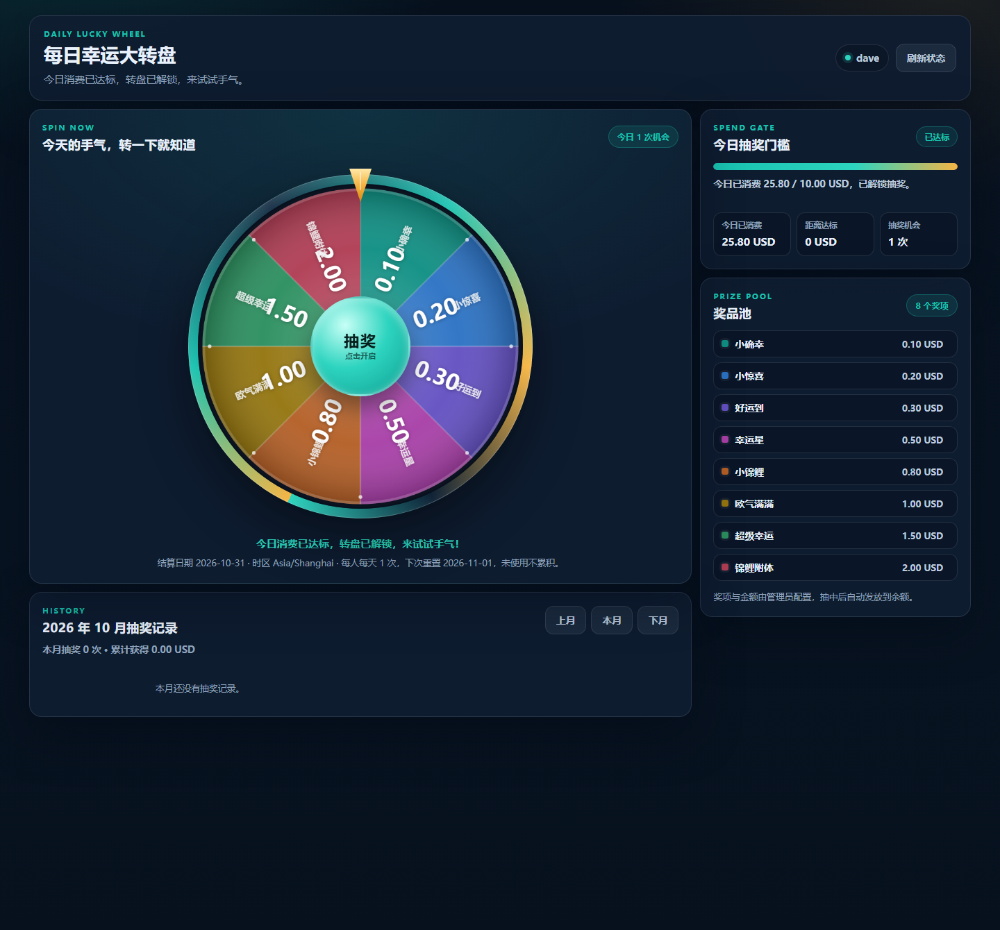
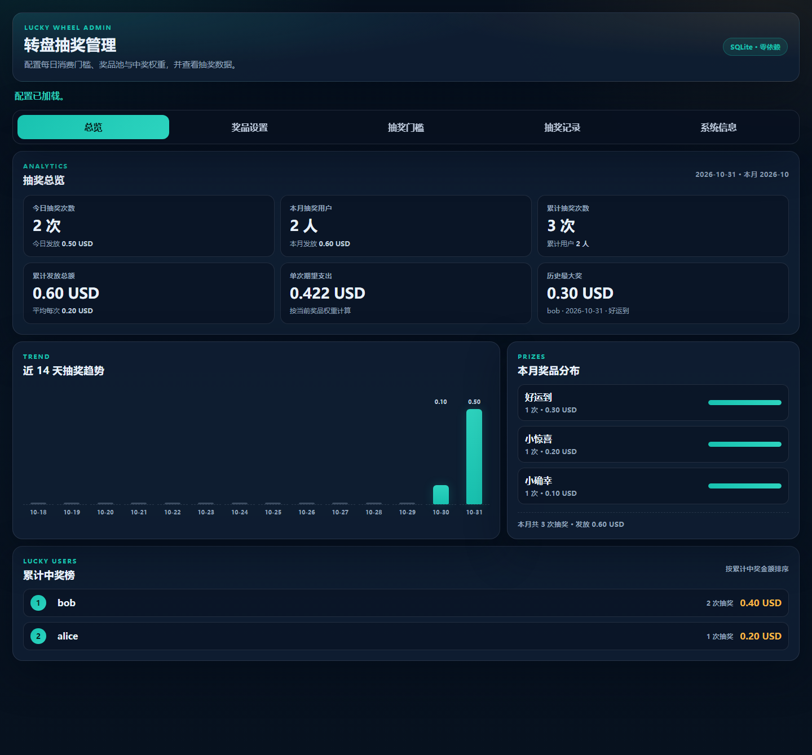
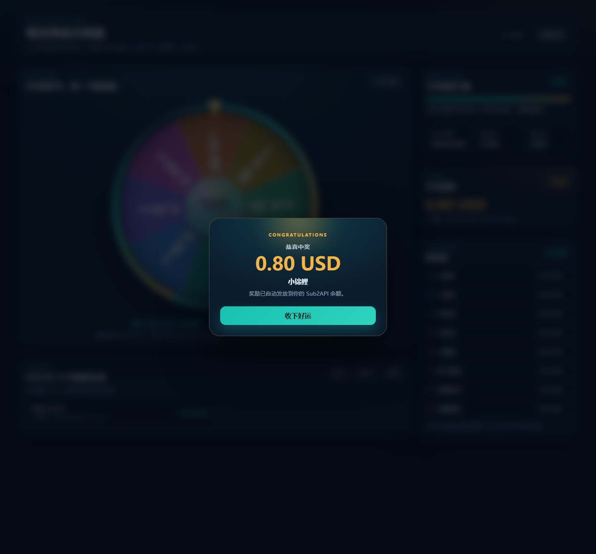
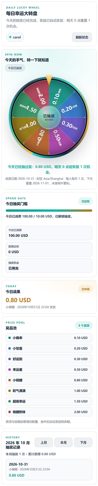

# sub2api-choujiang

一个可以接入 Sub2API 自定义 iframe 菜单的**每日幸运大转盘**服务。用户当天在 Sub2API 消费达到门槛（默认 10 USD）后，可以在转盘上抽一次奖，奖励直接加到该用户的 Sub2API 余额；没抽奖的日子不会累积，第二天重新获得 1 次机会。

- 零 npm 依赖，单进程 Node.js 服务，数据存 SQLite
- 消费门槛、奖品池、权重、颜色、概率公示全部可在管理后台调整
- 按服务端时区每天 0 点重置，每人每天最多 1 次
- 转盘扇区等分，中奖概率按权重计算（扇区大小不等于概率）
- 奖品金额为 0 时只记录结果，不调用余额接口
- 用户页支持深色/浅色、桌面/移动端、iframe 紧凑模式





中奖结果弹窗：



移动端（浅色 / iframe 紧凑模式）：



## 功能

- **每日抽奖**：登录用户每天 1 次，次日 0 点重置，未使用不累积。
- **消费门槛**：默认当天消费满 10 USD 才能抽奖，可后台开关和修改金额。
- **权重抽奖**：每个奖品可配置金额、权重、启用状态和扇区颜色；使用 `crypto.randomInt` 做安全随机。
- **余额发放**：中奖后调用 Sub2API 管理员余额接口，备注写入抽奖日期和奖品名；失败会返回错误并允许重试。
- **管理后台**：总览统计、14 天趋势、奖品分布、中奖榜、抽奖记录搜索/CSV 导出、门槛设置、系统信息与部署检查。
- **抽奖记录**：用户页按月查看自己的记录，中奖结果弹窗展示。
- **同源接入**：前端自动读取 Sub2API 的登录 token（URL、localStorage、cookie），适合反代到 Sub2API 同域名下的子路径。

## 抽奖规则

1. 用户打开页面时，服务端用当前 Sub2API 登录态调用 `/api/v1/auth/me` 确认用户身份。
2. 若开启了消费门槛，服务端查询该用户“当天”的消费金额；达到门槛才允许抽奖。
3. 每人每天只能成功抽 1 次，数据库用 `UNIQUE(user_id, date)` 约束兜底。
4. 中奖后按奖品金额调用 Sub2API 管理员接口加余额，金额为 0 则不调用。
5. 抽奖日期按 `LOTTERY_TIMEZONE`（默认 `Asia/Shanghai`）计算，0 点进入新的一天，机会重置为 1 次。

> 服务按单实例部署设计。SQLite 和进程内锁能保证单实例并发安全；不要用多个副本同时连同一个数据库对外服务。

## 快速开始

要求 Node.js **>= 22.5**（使用内置 `node:sqlite`，启动时出现 SQLite ExperimentalWarning 属正常现象）。

```bash
cp .env.example .env
# 编辑 .env，至少填写 Sub2API 地址、管理员 API Key、管理密码
npm run start:env
```

打开：

- 用户页：`http://127.0.0.1:8788/choujiang/`
- 管理后台：`http://127.0.0.1:8788/choujiang/admin/`

健康检查：

```bash
curl http://127.0.0.1:8788/choujiang/healthz
```

## 配置

所有配置都通过环境变量提供，`.env.example` 有完整注释。首次启动时，消费门槛和默认奖品会写入 SQLite；之后以管理后台的设置为准。

### 基础配置

| 变量 | 默认值 | 说明 |
| --- | --- | --- |
| `PORT` | `8788` | 监听端口 |
| `PUBLIC_BASE_PATH` | `/` | 对外路径前缀，反代到 `/choujiang/` 时填 `/choujiang` |
| `LOTTERY_DB_FILE` | `./data/lottery.db` | SQLite 文件路径，相对项目根目录 |
| `LOTTERY_UNIT` | `USD` | 金额单位，仅用于展示和备注 |
| `LOTTERY_TIMEZONE` | `Asia/Shanghai` | 计算“今天”的时区 |
| `LOTTERY_ADMIN_PASSWORD` | 空 | 管理后台密码；为空时管理端禁用 |
| `LOTTERY_NOTE_PREFIX` | `Lucky wheel draw` | 余额备注前缀 |
| `LOTTERY_SHOW_PROBABILITY` | `false` | 用户页是否显示每个奖项的概率 |
| `PUBLIC_TOKEN_STORAGE_KEYS` | 见 `.env.example` | 读取 Sub2API 登录 token 的 localStorage key 列表 |

### 门槛与奖品

| 变量 | 默认值 | 说明 |
| --- | --- | --- |
| `LOTTERY_REQUIRE_DAILY_SPEND` | `true` | 首次启动时是否开启消费门槛 |
| `LOTTERY_REQUIRED_DAILY_SPEND` | `10` | 首次启动时的门槛金额 |
| `LOTTERY_PRIZES` | 内置 8 个奖项 | 首次启动写入的奖品池，支持 JSON 数组或 `金额:权重:名称` 逗号分隔 |

`LOTTERY_PRIZES` 示例：

```dotenv
LOTTERY_PRIZES=0.1:280:小确幸,0.2:220:小惊喜,0.3:160:好运到,0.5:120:幸运星,0.8:90:小锦鲤,1:70:欧气满满,1.5:40:超级幸运,2:20:锦鲤附体
```

权重不需要加和为固定值；概率 = 单奖项权重 / 启用奖项权重总和。管理后台最多支持 16 个奖项。

### Sub2API 接入

| 变量 | 默认值 | 说明 |
| --- | --- | --- |
| `SUB2API_BASE_URL` | `http://127.0.0.1:3000` | Sub2API 地址 |
| `SUB2API_AUTH_ME_PATH` | `/api/v1/auth/me` | 当前用户接口 |
| `SUB2API_ADMIN_API_KEY` | 空 | 管理员 API Key，只存在服务端 |
| `SUB2API_ADMIN_AUTH_HEADER` | `x-api-key` | 余额接口鉴权头 |
| `SUB2API_ADMIN_AUTH_VALUE` | 空（回退到 API Key） | 余额接口鉴权值 |
| `SUB2API_BALANCE_PATH_TEMPLATE` | `/api/v1/admin/users/{id}/balance` | 加余额接口，`{id}` 为用户 ID |
| `SUB2API_BALANCE_OPERATION` | `add` | 接口语义，默认加余额 |
| `SUB2API_BALANCE_AMOUNT_FIELD` | `balance` | 请求体金额字段名 |

消费查询默认使用 Sub2API 自带的批量用户用量接口，**通常不需要配置**：

```text
POST /api/v1/admin/dashboard/users-usage
body: {"user_ids":[{id}]}
读取: data.stats.{id}.today_actual_cost
```

鉴权默认复用 `SUB2API_ADMIN_API_KEY`，请求头为 `x-api-key`。这里的 Key 必须是 Sub2API 管理后台里的 **Admin API Key**，不是用户 API Key，也不是登录 JWT；否则会返回 401/403，页面提示“Sub2API 拒绝了消费查询”。

只有你的 Sub2API 版本接口不同，才需要自定义以下变量：

| 变量 | 默认值 | 说明 |
| --- | --- | --- |
| `SUB2API_DAILY_SPEND_METHOD` | `POST` | 消费查询方法 |
| `SUB2API_DAILY_SPEND_PATH_TEMPLATE` | `/api/v1/admin/dashboard/users-usage` | 消费查询路径 |
| `SUB2API_DAILY_SPEND_BODY_TEMPLATE` | `{"user_ids":[{id}]}` | 请求体模板 |
| `SUB2API_DAILY_SPEND_AMOUNT_FIELD` | `data.stats.{id}.today_actual_cost` | 金额字段路径 |
| `SUB2API_DAILY_SPEND_AUTH_HEADER` | `x-api-key` | 鉴权头 |
| `SUB2API_DAILY_SPEND_AUTH_VALUE` | 空（回退到 Admin API Key） | 鉴权值 |

自定义查询支持以下占位符：

```text
{id} {userId} {user_id}          用户 ID
{date}                           当天日期 YYYY-MM-DD
{start} {end}                    当天 00:00 与次日 00:00 的日期
{start_date} {end_date}          同 {start} {end}
{start_iso} {end_iso}            当天起止的 ISO 时间
{start_ts} {end_ts}              秒级时间戳
{start_ms} {end_ms}              毫秒级时间戳
```

自定义 GET 示例：

```dotenv
SUB2API_DAILY_SPEND_METHOD=GET
SUB2API_DAILY_SPEND_PATH_TEMPLATE=/api/v1/admin/users/{id}/usage?date={date}
SUB2API_DAILY_SPEND_BODY_TEMPLATE=
SUB2API_DAILY_SPEND_AMOUNT_FIELD=data.today_cost
```

自定义鉴权示例（一般不需要）：

```dotenv
SUB2API_DAILY_SPEND_AUTH_HEADER=Authorization
SUB2API_DAILY_SPEND_AUTH_VALUE=Bearer your-admin-token
```

## 生产部署

推荐让抽奖页和 Sub2API 保持在**同一个域名**下：

```text
用户浏览器 -> https://你的-sub2api-域名/choujiang/ -> 反代 -> sub2api-choujiang:8788
用户浏览器 -> https://你的-sub2api-域名/          -> 反代 -> Sub2API
```

这样 iframe 里的前端才能读取 Sub2API 的登录 token（localStorage/cookie），不需要把 token 拼在 URL 上。

### 1. 准备目录与配置

```bash
git clone https://github.com/your-github-name/sub2api-choujiang.git
cd sub2api-choujiang
cp .env.example .env
mkdir -p data
```

编辑 `.env`，至少修改：

```dotenv
SUB2API_BASE_URL=http://host.docker.internal:18080
SUB2API_ADMIN_API_KEY=你的-sub2api-admin-api-key
LOTTERY_ADMIN_PASSWORD=换成一个强密码
LOTTERY_TIMEZONE=Asia/Shanghai
```

这里的 `SUB2API_ADMIN_API_KEY` 必须是 Sub2API 管理后台的 **Admin API Key**。余额发放和消费查询都会用它；消费查询默认走：

```text
POST /api/v1/admin/dashboard/users-usage
x-api-key: <Admin API Key>
body: {"user_ids":[<用户ID>]}
读取: data.stats.<用户ID>.today_actual_cost
```

所以正常情况下**不需要**再配 `SUB2API_DAILY_SPEND_*`。

`SUB2API_BASE_URL` 的选择：

- 抽奖服务在 Docker、Sub2API 在宿主机：`http://host.docker.internal:18080`
- 两者在同一个 Docker Compose 网络：`http://sub2api:3000`
- 两者都不在 Docker、在同一台机器：`http://127.0.0.1:3000`
- 通过公网 HTTPS 域名访问 Sub2API 且容器可访问：`https://你的-sub2api-域名`

`docker-compose.yml` 已包含 `host.docker.internal:host-gateway`，Linux 上也可用。

### 2. 启动

使用已发布的镜像（把 `your-github-name` 换成实际用户名）：

```bash
docker compose pull
docker compose up -d
docker logs -f sub2api-choujiang
```

或本地构建：

```bash
docker compose -f docker-compose.yml -f docker-compose.build.yml up -d --build
```

健康检查：

```bash
curl http://127.0.0.1:8788/choujiang/healthz
```

数据保存在 `./data/lottery.db`，继续挂载 `./data:/app/data` 即可在升级容器时保留数据。

### 3. 配置反向代理

Caddy（域名根路径给 Sub2API，`/choujiang/*` 分流给本服务）：

```caddyfile
ai.example.com {
  handle /choujiang/* {
    reverse_proxy 127.0.0.1:8788
  }

  handle {
    reverse_proxy 127.0.0.1:3000
  }
}
```

Nginx：

```nginx
location /choujiang/ {
    proxy_pass http://127.0.0.1:8788;
    proxy_http_version 1.1;
    proxy_set_header Host $host;
    proxy_set_header X-Real-IP $remote_addr;
    proxy_set_header X-Forwarded-For $proxy_add_x_forwarded_for;
    proxy_set_header X-Forwarded-Proto $scheme;
}
```

注意：

- 推荐**保留** `/choujiang` 前缀，`.env` 里保持 `PUBLIC_BASE_PATH=/choujiang`。
- 如果反代用 `handle_path` 或 `rewrite` 去掉了前缀，则把 `PUBLIC_BASE_PATH` 改成 `/`。
- 必须通过 HTTPS 访问（Sub2API 登录 cookie 通常要求安全上下文）。

### 4. 添加 Sub2API 自定义菜单

在 Sub2API 管理后台添加自定义菜单：

```text
名称：每日抽奖
URL：https://你的-sub2api-域名/choujiang/?theme=dark&ui_mode=embedded
可见性：用户
打开方式：iframe
```

管理后台地址（不要暴露给普通用户）：

```text
https://你的-sub2api-域名/choujiang/admin/
```

支持的页面参数：

- `theme=dark|light|auto`：深色、浅色或跟随系统（默认跟随系统）。
- `ui_mode=embedded`：去掉外层背景和阴影，使用更紧凑的 iframe 布局。
- `lang=zh|en`：设置页面语言标记，界面文案仍以中文为主。

如果 Sub2API 打开 iframe 时会自动追加 `theme`、`lang`、`ui_mode`，用户页会自动适配。

### 5. 首次配置

1. 打开 `/choujiang/admin/`，输入 `LOTTERY_ADMIN_PASSWORD`。
2. 在“奖品设置”里确认金额、权重、启用状态和扇区颜色，保存。
3. 在“抽奖门槛”里确认开关和金额（默认 10 USD），保存。
4. 用普通用户打开抽奖页，确认能读到消费金额和剩余次数。
5. 用测试账号抽一次，确认 Sub2API 余额到账、记录和统计正常。

### 6. 更新版本

```bash
docker compose pull
docker compose up -d
docker logs -f sub2api-choujiang
```

如果镜像是本地构建的，改用：

```bash
docker compose -f docker-compose.yml -f docker-compose.build.yml up -d --build
```

> 旧版 `.env` 里的 `Authorization: Bearer your-admin-token` 会被新版本自动忽略，并回退到 `SUB2API_ADMIN_API_KEY` + `x-api-key`；改完代码重启即可，不必手动删配置。

### 7. 备份与恢复

```bash
# 停服务后直接复制 SQLite 文件（包含 WAL）
docker compose stop sub2api-choujiang
cp data/lottery.db data/lottery.db.bak
docker compose start sub2api-choujiang
```

恢复时用备份文件覆盖 `data/lottery.db` 再启动即可。

## 镜像发布

仓库包含 `.github/workflows/docker-publish.yml`。推送到 `master` / `main` 分支或推送 `v*` tag 时，GitHub Actions 会构建 `linux/amd64`、`linux/arm64` 多架构镜像并推送到：

```text
ghcr.io/<你的-github-用户名>/sub2api-choujiang:latest
ghcr.io/<你的-github-用户名>/sub2api-choujiang:<tag>
ghcr.io/<你的-github-用户名>/sub2api-choujiang:sha-<commit>
```

发布前把 `docker-compose.yml` 里的 `image` 改成同一路径。首次使用 GHCR 时，如果服务器拉取镜像提示无权限，先执行：

```bash
echo <你的-github-token> | docker login ghcr.io -u <你的-github-用户名> --password-stdin
```

## 管理后台

- **总览**：今日/本月/累计抽奖次数、参与人数、发放金额、平均支出、单次期望支出、历史最大奖、14 天趋势、奖品分布、中奖榜。
- **奖品设置**：编辑金额、权重、启用状态、扇区颜色，实时预览概率和期望支出；支持新增/删除奖项（最多 16 个）。
- **抽奖门槛**：开启/关闭消费门槛，修改门槛金额，保存后对新抽奖立即生效。
- **抽奖记录**：搜索用户/日期/奖品，导出 CSV；默认展示最近记录。
- **系统信息**：Sub2API 地址、接口模板、鉴权配置、数据库路径、时区和部署检查项。

概率只在管理端展示；用户页是否展示概率由“公示中奖概率”开关控制，默认关闭。

## API

所有接口都在 `PUBLIC_BASE_PATH` 下，例如 `/choujiang/api/me`。

| 方法 | 路径 | 鉴权 | 说明 |
| --- | --- | --- | --- |
| GET | `/healthz` | 无 | 健康检查 |
| GET | `/api/config` | 无 | 奖品池、门槛、单位、时区等公开配置 |
| GET | `/api/me` | Sub2API 登录态 | 当前用户、今日抽奖状态、剩余次数、资格 |
| GET | `/api/history?month=YYYY-MM` | Sub2API 登录态 | 指定月份的抽奖记录 |
| POST | `/api/draw` | Sub2API 登录态 | 抽奖；已抽过返回 `alreadyDrawn: true` |
| GET | `/api/admin/config` | 管理密码 | 管理端完整配置、统计、最近记录 |
| PUT | `/api/admin/config` | 管理密码 | 保存奖品、门槛、备注前缀、概率开关 |

管理密码请求头：`X-Lottery-Admin-Password`，也兼容 `Authorization: Bearer <password>` 和 Basic Auth。

## 日志

服务输出单行 JSON 日志，事件名包括：

- `service.started`：启动配置（不含密钥）
- `sub2api.user.verified`：用户身份校验成功
- `draw.success` / `draw.duplicate` / `draw.spend_not_enough`
- `admin.config.updated`
- `request.error`：未捕获异常

用 `docker logs -f sub2api-choujiang` 查看。

## 常见问题

**页面显示“无法读取当前登录用户”**

抽奖页必须与 Sub2API 同源，或者从 URL 传入 `?token=`。检查反代是否保留了 `/choujiang` 前缀，以及 `PUBLIC_BASE_PATH` 是否一致。

**显示消费金额查询失败**

页面会给出具体原因：

- “Sub2API 拒绝了消费查询” → `SUB2API_ADMIN_API_KEY` 不是管理后台的 Admin API Key，或 `.env` 里仍残留 `Authorization: Bearer your-admin-token`。新版会自动忽略占位值并改用 `x-api-key`，升级后重启即可。
- “没有找到消费查询接口（404）” → 自定义的 `SUB2API_DAILY_SPEND_PATH_TEMPLATE` 与 Sub2API 版本不匹配，删除自定义配置或改成 `/api/v1/admin/dashboard/users-usage`。
- “无法从 Sub2API 响应解析今日消费金额” → 接口返回结构不同，调整 `SUB2API_DAILY_SPEND_AMOUNT_FIELD`；服务端日志里会打印实际响应。

也可以在管理后台“系统信息”里核对消费查询方法、鉴权头、接口模板和金额字段。

**抽奖成功但余额没到账**

查看服务日志里的上游状态码。确认 `SUB2API_BALANCE_PATH_TEMPLATE`、`SUB2API_ADMIN_API_KEY` 和字段名正确；发奖失败会返回错误，用户可重试。

**用户说昨天没抽，今天怎么只有 1 次**

这是设计行为：每天重置为 1 次，未使用不累积。

**能不能多实例部署**

不建议。单实例 + 进程内锁 + SQLite 唯一约束才能保证不重复发奖；要多实例需要改用外部数据库和分布式锁。

## 开发

```bash
npm run check   # 语法检查
npm run dev     # node --watch
```

项目结构：

```text
src/
  server.js      HTTP 路由、抽奖流程、管理端聚合
  sub2api.js     Sub2API 登录、余额、消费查询
  store.js       SQLite 数据访问
  prizes.js      奖品校验、权重抽奖
  config.js      环境变量
  time.js        时区与日期范围
  pages.js       用户页/管理页 HTML
public/
  app.js         转盘、抽奖、历史
  admin.js       管理后台
  styles.css     用户页样式
  admin.css      管理后台样式
```
